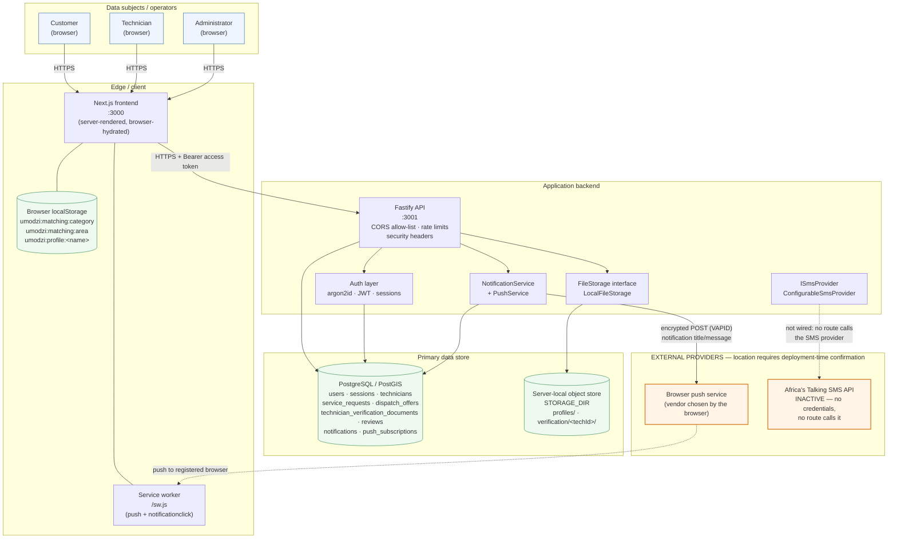
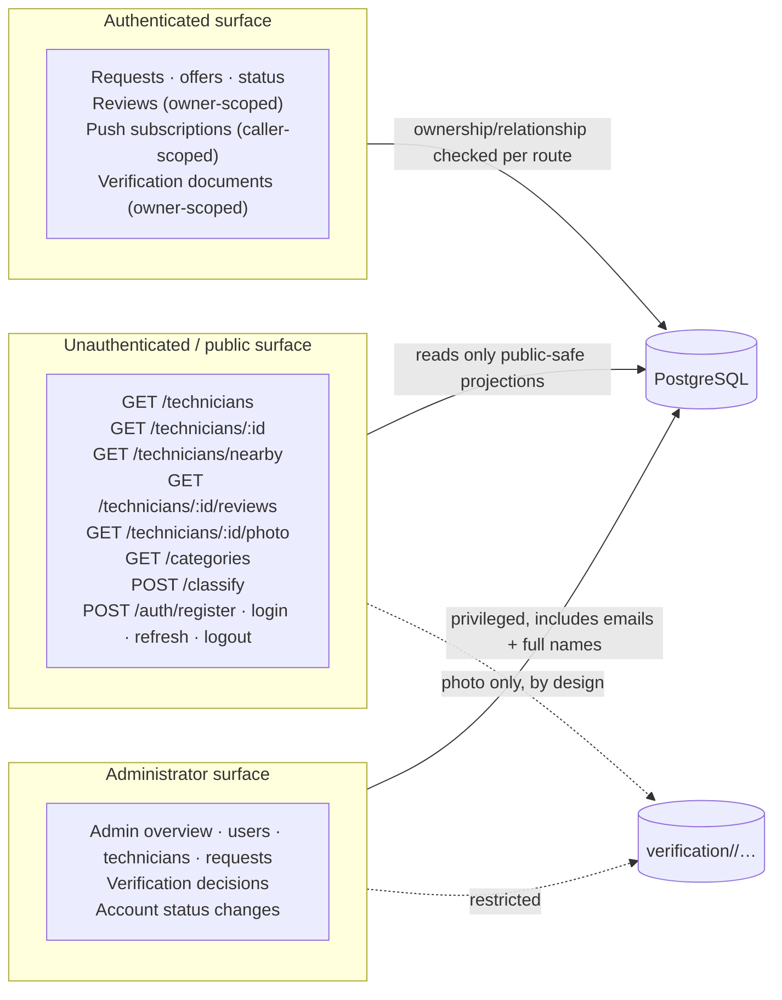
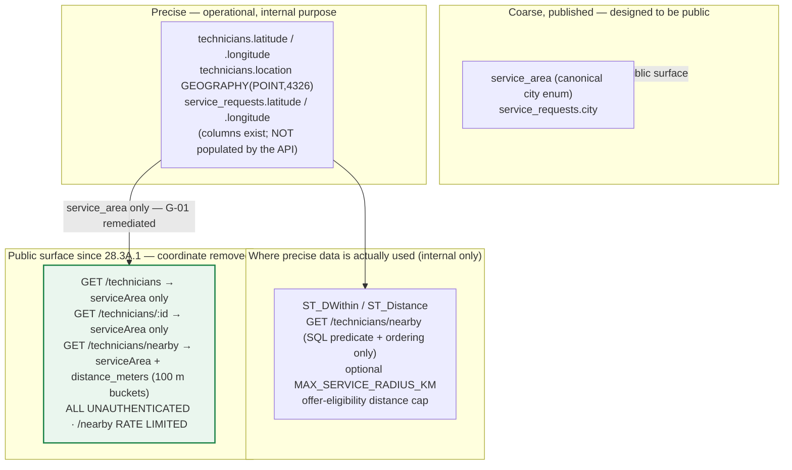
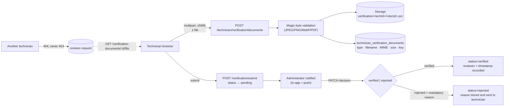
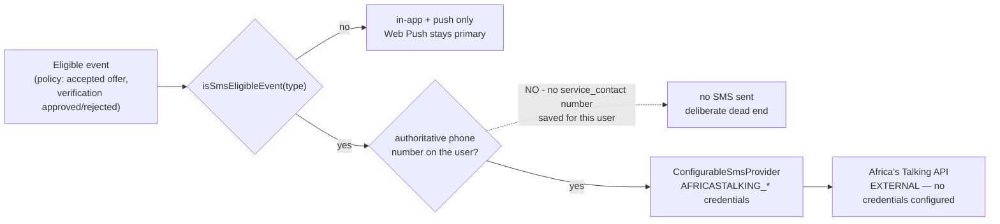
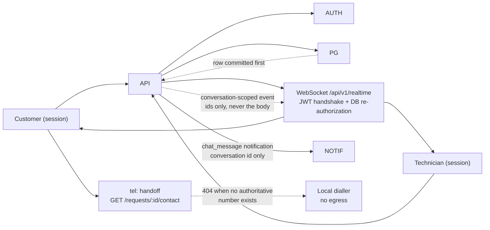
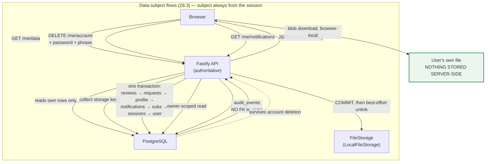
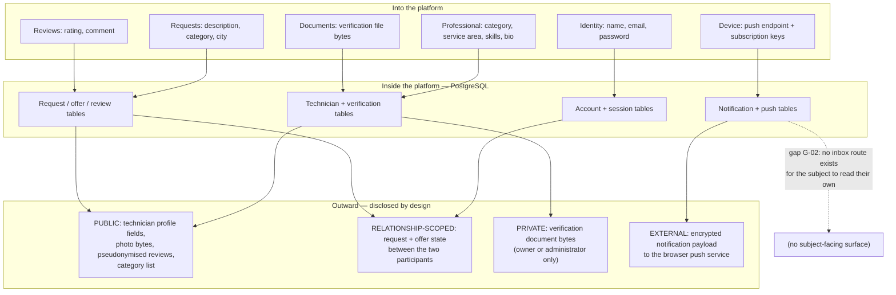

# Umodzi Connect — Data Flow Architecture

**Task:** 28.3A. **Basis:** the routes, services and storage actually present in the codebase.
External providers are marked distinctly. Components that are *planned but not implemented* are
drawn in a separate section so they cannot be mistaken for live data flows.

> **Status of this document.** Umodzi Connect is an academic project. This diagram describes
> what the code does and where data flows. It makes **no** claim that the platform is legally
> compliant, registered with the Data Protection Commission, or covered by an appointed data
> protection officer. Statements about purposes and controllers/processors are observations about
> the operating model and **require legal/organizational confirmation**.

---

## 1. Verified runtime topology



### What the diagram deliberately does **not** show

- **No Supabase client anywhere.** Verified: `Select-String 'supabase'` across `backend/src/**`
  returns no matches — no SDK import, no bucket API, no service-role key reference. Storage is a
  server-local adapter behind an interface. The production *target* named in configuration is
  Supabase PostgreSQL/PostGIS (PostGIS extension, database only).
- **No direct browser → database or browser → storage path.** The frontend receives only an API
  base URL and the **public** VAPID key.
- **No AI/ML vendor.** Category classification is deterministic keyword rules inside the API.
- **No analytics, advertising or third-party tracking.**

---

## 2. Trust boundary map



**The public surface is the privacy-sensitive one.** Everything returned from the six public read
endpoints is reachable without a session. The concrete consequence identified in 28.3A, and
**corrected in 28.3A.1**:

> ~~Technician `latitude`/`longitude` (and the derived `distanceKm`) are returned by
> `GET /technicians`, `GET /technicians/:id` and `GET /technicians/nearby`, all unauthenticated.~~
>
> **As of 28.3A.1 no public route returns a stored coordinate.** Public technician information
> conveys location as the self-declared `serviceArea` only. `GET /technicians/nearby` retains its
> PostGIS radius search — the `location` point is used inside the SQL predicate and ordering, never
> projected — and returns `distance_meters` coarsened to a 100 m bucket, on a rate-limited route.
> Precise coordinates remain an internal dispatch input only.

---

## 3. Flows by data category

### 3.1 Registration and authentication

```mermaid
sequenceDiagram
  autonumber
  participant B as Browser
  participant F as Next.js frontend
  participant A as Fastify API
  participant D as PostgreSQL

  B->>F: POST /auth/register (email, password, names, role, category?, serviceArea?)
  F->>A: HTTPS + JSON
  A->>A: Zod validate · rate limit (15/min)
  A->>A: argon2id hash(password)
  A->>D: INSERT users (+ technicians row for technician role)
  A->>D: INSERT technicians.location (seeded approximate city point)
  D-->>A: row
  A-->>B: 201 { id, email, role, names, accountStatus }

  Note over B,D: Login compares against argon2id only; one generic error on failure
  B->>A: POST /auth/login
  A->>D: INSERT sessions (SHA-256 token hash only)
  A-->>B: access JWT (sub/role/jti, 15 min) + HttpOnly refresh cookie
```

Plaintext passwords exist only in request memory; only the argon2id digest and a SHA-256 token
hash are persisted.

### 3.2 Location processing — public vs operational

This is the distinction 28.3A was specifically asked to document.



Key verified facts:

- **No real GPS anywhere.** There is **no geolocation API call** in the frontend code — no
  `getCurrentPosition`, no `watchPosition`, no `navigator.geolocation` call in
  `frontend/app/**`, `frontend/components/**` or `frontend/lib/**`. (The identifier appears only
  inside **comments** in `mapData.ts`, documenting a future replacement seam.)
- **The frontend map helper is explicit about this:** `frontend/lib/mapData.ts` states its
  coordinates are "deterministic mock values… NOT real GPS locations and NOT real technician
  positions" and performs no geolocation.
- **Technician coordinates at registration are hard-coded approximate city-centre seeds**, not a
  technician's home or current position.
- **Customer request coordinates are schema-ready but never populated** by the API.
- **Since 28.3A.1 no public route projects a stored coordinate.** The prototype map's technician
  pins are derived from the technician's declared `service_area` city centre
  (`getServiceAreaPoint()` in `frontend/lib/mapData.ts`), so the displayed map distance is an
  area-level figure between two city centres rather than a true technician distance.
- Location data is treated as personal data throughout this documentation.

### 3.3 Verification documents — higher-risk flow



Control properties worth noting: cross-technician requests return **404 rather than 403** so
document existence does not leak; document mutation is blocked with 409 once submitted or
decided; the rejection reason is **mandatory**; `verification_reviewed_by` is `ON DELETE SET
NULL` so deleting an administrator anonymises the reviewer instead of orphaning the decision.

### 3.4 Notification and push flow

```mermaid
sequenceDiagram
  autonumber
  participant R as Business route<br/>(offer / status / verification)
  participant N as NotificationService
  participant D as PostgreSQL
  participant P as PushService (web-push)
  participant X as Browser push service<br/>EXTERNAL
  participant B as Service worker

  R->>R: business write COMMITS first
  R->>N: recordEventNotification(recipient from DB relationship only)
  N->>D: BEGIN → advisory lock on natural key
  N->>D: INSERT ... status='pending' (dedupe: existing row returned instead)
  N->>D: COMMIT
  N->>P: sendPushToUser(user_id, {title, body, data})
  P->>D: SELECT subscriptions for user
  loop each subscription (independent try/catch)
    P->>X: encrypted POST (aes128gcm) + VAPID
    alt 2xx acceptance
      X-->>P: accepted
    else 404 / 410
      X-->>P: gone
      P->>D: DELETE subscription
    else other failure
      X-->>P: error
      P->>P: record failure, continue to next device
    end
  end
  P-->>N: { sent, failed }
  alt sent > 0
    N->>D: UPDATE notifications SET status='sent', sent_at=NOW()
  else sent = 0
    N->>D: UPDATE notifications SET status='failed', failure_reason=<honest reason>
  end
  N-->>R: never throws — logged, business response unaffected
  X-.->|push delivered to browser| B
  B->>B: showNotification + notificationclick handling
```

Honest-delivery guarantees encoded here:

- Business write commits **before** any notification or provider work — no distributed
  transaction, no rollback of a business operation by a notification failure.
- **No provider call inside a database transaction.**
- `sent` is set **only** on genuine provider acceptance — never because the row was inserted.
- `provider_message_id` stays NULL: the Web Push protocol returns no per-message identifier, and
  none is ever fabricated.
- Dedupe on `(user_id, type, reference_type, reference_id)` means a repeated event neither
  duplicates nor re-pushes.
- Missing VAPID configuration fails honestly and claims no delivery.

### 3.5 SMS — designed but not active



Verified state: the Africa's Talking adapter and the policy gate both exist. Migration
`008_communication_phone.sql` now adds `user_phones`, an **optional, self-service** number a
user stores on their own account for service contact (`purpose = 'service_contact'`). That
table is read by exactly one route, `GET /api/v1/requests/:id/contact`, which returns the
number (or an honest **404**) so the browser can offer a `tel:` link. It is **not** wired into
any SMS path: no route calls `ConfigurableSmsProvider`, the notification policy still gates
SMS behind an SMS-eligible event, and `chat_message` notifications are in-app + push only.
SMS therefore remains inactive and no SMS has ever been sent by this system — the dead end is
still deliberate, it is just no longer caused by a missing column.

---

### 3.6 Communication — conversations, messages and phone (28.4)



Rules that make the diagram honest:

- **Persistence is authoritative.** `POST /conversations/:id/messages` inserts the row and only
  *then* publishes the realtime event. The socket transport never holds message text in memory,
  and a transport failure never fails a persisted message.
- **Authorization is server-derived at both layers.** HTTP requires `requireAuth` plus
  `canAccessConversation()` / `canCommunicateOnRequest()`. The WebSocket handshake re-verifies the
  access token with the same verifier used by HTTP, re-reads the account from PostgreSQL, and
  re-runs `canAccessConversation()` on every `subscribe` — a client can never assert membership.
- **Realtime is optional; REST is not.** Without the `ws` package installed, the transport factory
  returns null, logs that realtime is inactive, and every flow above still completes over REST.
  The chat UI reports "live updates are paused" rather than claiming a connection it does not have.
- **The phone flow does not egress.** `/requests/:id/contact` returns an authoritative number or
  404; the browser only ever receives a `tel:` link and hands off to the local dialler.
- **No message text and no phone number enters a notification payload, a push body or a log line.**
  The `chat_message` notification carries the conversation id and nothing else.

**Data category:** §1.11 Communication data in the Data Inventory.

---

## 4. Third-party data-egress ledger

| Egress | Trigger | Data transmitted | Credential boundary | Location status |
|---|---|---|---|---|
| Browser push service | Notification with a live subscription | Encrypted notification title/message | VAPID **private** key, backend env only | **Requires deployment-time confirmation** |
| Africa's Talking SMS | Would require an SMS-eligible event **and** an SMS route (neither exists; `user_phones` is read only by `/requests/:id/contact`) | SMS body + recipient number | `AFRICASTALKING_*`, backend env only, currently empty | **Requires deployment-time confirmation**; inactive |
| Database host | Every request | Query results across all categories | `DATABASE_URL`, backend env only | **Requires deployment-time confirmation** |
| Object store | Photo/document read | File bytes | Storage root env only | Local filesystem today |

**No other egress path exists in the code.**

### 4.1 Privacy flows added in Task 28.3 — no new egress

None of the four stages below introduces a **new** egress path. Every one of them is a
movement of data **between the browser and the application's own API**, or between the API and
its own database and storage adapter. That is stated explicitly because "we added an export"
is exactly the kind of change that can quietly add a new destination.



Guarantees encoded in these flows:

- **No client-supplied subject.** There is no user id, recipient or owner parameter anywhere.
  The subject is `request.authUser`, re-read from PostgreSQL by `requireAuth`.
- **No export archive.** The JSON is assembled per request and the file is created in the
  browser, so there is nothing retained and nothing to purge.
- **Erasure is not a flag.** Relational rows are removed and committed, *then* stored objects
  are unlinked. A bare `DELETE FROM users` would **orphan** requests and the technician profile,
  because `service_requests.customer_user_id` and `technicians.user_id` are `ON DELETE SET NULL`.
- **The audit trail deliberately outlives the account.** `audit_events` has no foreign key to
  `users`, so honouring an erasure request does not destroy the accountability record. The
  retained count is shown to the user before they confirm.
- **Auditing is log-and-continue.** An audit write failure is logged and swallowed; it can
  never fail or roll back the business action.
- **No IP addresses.** None are stored by the application, and none were added for auditing.
- **Provider deletion is not claimed.** The system can delete its own records; it has no
  mechanism to request deletion from a push service or any other third party.

---

## 5. Client-side persistence

The frontend keeps three `localStorage` keys, all containing **user-entered form state only** —
no identity, no tokens, no personal data fetched from the API:

| Key | Content | Lifetime |
|---|---|---|
| `umodzi:matching:category` | selected service category (draft) | until cleared |
| `umodzi:matching:area` | selected service area (draft) | until cleared |
| `umodzi:profile:<technicianName>` | draft profile edits | until cleared |

Access tokens are **not** in `localStorage` or `sessionStorage`: the refresh token is an
HttpOnly cookie, and the access token is held in memory for the session. Verified precisely: no
`localStorage` key anywhere in the frontend carries a token, session, auth, JWT, email or user
id — the only three keys are the draft keys listed above. `sessionStorage` is never *used*; the
only textual occurrence is inside a source **comment** recording that tokens are never placed
there. The `ProfileEditor` component states this to users directly — "Changes are stored in this
browser only (localStorage) and survive refresh. No account …" — which is accurate.

Two consequences for the privacy notice: (a) clearing browser data clears the drafts, and (b) a
shared device leaves the selected category/area visible to the next user, which is minor but
should be disclosed.

**Task 28.3 added no new client-side persistence.** Verified: the three draft keys above are
still the only `localStorage` keys. In particular, the data-export file is created as a
`Blob` in memory and handed to the browser's own download mechanism — it is **not** written to
`localStorage`, `sessionStorage`, IndexedDB or any cache, and the object URL is revoked
immediately. The registration disclosure's checkbox state is component state only and is
deliberately **not** persisted: no consent record is stored server-side or client-side.

---

## 6. Movement summary (what crosses which boundary)



The dashed line is the finding that matters most for transparency: notification personal data is
collected and forwarded to an external provider, yet the data subject has no surface on which to
read, review or delete it. Either the route is added, or the notice must describe the actual
state accurately.